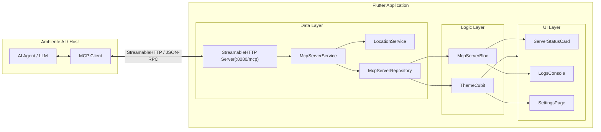

# Flutter Agent-Ready App (POC)

Un Proof of Concept (POC) che dimostra come rendere un'applicazione Flutter **"Agent-Ready"** integrando un server **MCP (Model Context Protocol)** in-app. 

Grazie a questo approccio, agenti AI (come Google Antigravity, Claude Desktop o qualunque client compatibile con MCP) possono interagire bidirezionalmente con l'applicazione in esecuzione, ispezionando lo stato del dispositivo ed eseguendo azioni native e modifiche dell'interfaccia utente in tempo reale.

---

## 🎯 Obiettivi del POC

- **Esposizione di capacità native agli LLM**: Consentire agli agenti AI di interrogare sensori e dati del dispositivo (es. geolocalizzazione GPS, orario di sistema).
- **Controllo dell'interfaccia da remoto**: Permettere agli agenti di modificare lo stato e l'aspetto dell'app (es. tema chiaro/scuro e navigazione contestuale).
- **Trasparenza e osservabilità**: Monitorare in tempo reale dall'interfaccia Flutter tutte le chiamate, i parametri e le risposte scambiate con il client MCP tramite una console di log interattiva.
- **Architettura pulita e scalabile**: Implementare la separazione delle responsabilità con il pattern raccomandato (UI, BLoC/Cubit, Repository, Service).

---

## 🏗️ Architettura del Sistema



L'applicazione segue una struttura a livelli ben definita:

- **Data Layer**:
  - [`McpServerService`](file:///Users/federico/Development/Progetti/personali/fluter-agent-ready-app/lib/data/services/mcp_server_service.dart): Inizializza l'istanza `FlutterMCP`, configura il trasporto `StreamableHTTP` su `http://0.0.0.0:8080/mcp`, registra i tool ed espone stream di log e richieste eventi.
  - [`LocationService`](file:///Users/federico/Development/Progetti/personali/fluter-agent-ready-app/lib/data/services/location_service.dart): Incapsula `geolocator` gestendo la verifica e la richiesta dei permessi e il recupero delle coordinate geografiche.
  - [`McpServerRepository`](file:///Users/federico/Development/Progetti/personali/fluter-agent-ready-app/lib/data/repositories/mcp_server_repository.dart): Fornisce un'interfaccia coerente per avvio, arresto e ascolto degli stream.
- **Logic Layer**:
  - [`McpServerBloc`](file:///Users/federico/Development/Progetti/personali/fluter-agent-ready-app/lib/logic/bloc/mcp_server/mcp_server_bloc.dart): Gestisce gli stati del server (`initial`, `startInProgress`, `running`, `stopped`, `startFailure`), la porta e la lista dinamica dei log.
  - [`ThemeCubit`](file:///Users/federico/Development/Progetti/personali/fluter-agent-ready-app/lib/logic/bloc/theme/theme_cubit.dart): Gestisce lo stato reattivo del `ThemeMode` (chiaro o scuro).
- **UI Layer**:
  - [`McpServerPage`](file:///Users/federico/Development/Progetti/personali/fluter-agent-ready-app/lib/ui/pages/mcp_server_page.dart): Schermata principale che include i controlli del server, la console e la gestione della navigazione reattiva.
  - [`ServerStatusCard`](file:///Users/federico/Development/Progetti/personali/fluter-agent-ready-app/lib/ui/widgets/server_status_card.dart): Badge di stato del server, pulsante Avvia/Arresta e indirizzo dell'endpoint.
  - [`LogsConsole`](file:///Users/federico/Development/Progetti/personali/fluter-agent-ready-app/lib/ui/widgets/logs_console.dart): Console nera con caratteri monospace per l'ispezione delle chiamate MCP.
  - [`SettingsPage`](file:///Users/federico/Development/Progetti/personali/fluter-agent-ready-app/lib/ui/pages/settings_page.dart): Schermata impostazioni con toggle manuale della Dark Mode.

---

## 🛠️ Tool MCP Esposti all'Agente

Il server registra tre tool standardizzati con schema JSON per permetterne l'invocazione automatica da parte dei modelli linguistici:

### 1. `get_location`
Restituisce la posizione geografica corrente del dispositivo (latitudine e longitudine).
- **Parametri di input**:
  ```json
  {
    "highAccuracy": false // (opzionale, boolean) Richiede GPS ad alta precisione
  }
  ```
- **Output di successo**:
  ```json
  {
    "latitude": 45.4642,
    "longitude": 9.1900
  }
  ```
- **Gestione errori**: Restituisce un errore se i permessi GPS sono negati o se i servizi di localizzazione sono disattivati.

### 2. `get_device_time`
Restituisce data, ora, fuso orario e offset correnti del dispositivo.
- **Parametri di input**:
  ```json
  {
    "utc": false // (opzionale, boolean) Se true, restituisce l'orario in formato UTC
  }
  ```
- **Output di successo**:
  ```json
  {
    "iso": "2026-10-12T01:05:00.000",
    "time": "01:05:00",
    "date": "2026-10-12",
    "isUtc": false,
    "timeZoneName": "CEST",
    "timeZoneOffset": "2:00:00.000000"
  }
  ```

### 3. `set_theme`
Modifica il tema visivo dell'applicazione Flutter (chiaro o scuro).
- **Parametri di input**:
  ```json
  {
    "mode": "dark" // (richiesto, string) Valori consentiti: "light" | "dark"
  }
  ```
- **Comportamento reattivo nell'app**:
  1. Aggiorna lo stato globale tramite `ThemeCubit`.
  2. L'interfaccia aggiorna istantaneamente i colori (Material 3).
  3. L'applicazione esegue un push automatico verso la [`SettingsPage`](file:///Users/federico/Development/Progetti/personali/fluter-agent-ready-app/lib/ui/pages/settings_page.dart) (se non già aperta) per mostrare all'utente l'avvenuto cambio di stato.
- **Output di successo**:
  ```text
  Tema attivo: dark
  ```

---

## 🖥️ Funzionalità dell'Interfaccia Utente

| Componente | Descrizione |
|---|---|
| **Server Status Card** | Mostra visivamente se il server è attivo (indicatore verde) o fermo (grigio), l'URL di connessione (`http://localhost:8080/mcp`) e un pulsante per avviare o arrestare il server con un tap. |
| **Console dei Log in tempo reale** | Visualizza in stile terminale le richieste in ingresso (`Tool ← ...`) con i rispettivi argomenti e le risposte generate (`Tool → ...`), facilitando il debug immediato delle interazioni agent-app. |
| **Pulisci Log** | Permette di azzerare la cronologia dei log registrati nella console. |
| **Dark Mode & Reattività** | Pieno supporto a Material 3 in modalità chiara e scura, controllabile sia manualmente dallo switch nelle impostazioni, sia programmaticamente tramite agenti. |

---

## 🔌 Configurazione del Client MCP

Per connettere un agent o un IDE (ad esempio Antigravity o Claude Desktop) all'applicazione Flutter in esecuzione, aggiungi la configurazione al file di configurazione MCP (es. `mcp_config.json`):

```json
{
  "mcpServers": {
    "flutter-agent-ready-app": {
      "serverUrl": "http://localhost:8080/mcp"
    }
  }
}
```

> [!NOTE]
> Il server utilizza il protocollo **StreamableHTTP** sulla porta `8080` con endpoint `/mcp`. Assicurati che l'app sia avviata e che il server sia attivo prima che il client provi a invocare i tool.

---

## 🚀 Come Eseguire il Progetto

### Prerequisiti
- Flutter SDK (versione compatibile con Dart `^3.13.4`)
- Un emulatore/simulatore o un dispositivo fisico connesso (macOS Desktop, Android, iOS)

### Passaggi

1. **Clona ed entra nel repository**:
   ```bash
   git clone <url-del-repo>
   cd fluter-agent-ready-app
   ```

2. **Installa le dipendenze**:
   ```bash
   flutter pub get
   ```

3. **Avvia l'applicazione**:
   ```bash
   flutter run
   ```

4. **Avvia il server MCP**:
   - Una volta aperta l'app, premi il pulsante **"Avvia"** nella card di stato in cima allo schermo.
   - Il server sarà disponibile su `http://localhost:8080/mcp`.
   - Connetti il tuo client MCP o AI Agent e inizia a inviare comandi!

---

## 📦 Dipendenze Principali

- [`flutter_mcp`](https://pub.dev/packages/flutter_mcp): Framework per l'integrazione del server Model Context Protocol all'interno di app Flutter.
- [`flutter_bloc`](https://pub.dev/packages/flutter_bloc) & [`bloc`](https://pub.dev/packages/bloc): Gestione dello stato dell'applicazione e separazione della logica di business.
- [`geolocator`](https://pub.dev/packages/geolocator): Plugin per l'accesso e la gestione dei permessi e coordinate GPS su piattaforme mobili e desktop.
- [`equatable`](https://pub.dev/packages/equatable): Utility per la comparazione per valore degli stati BLoC.